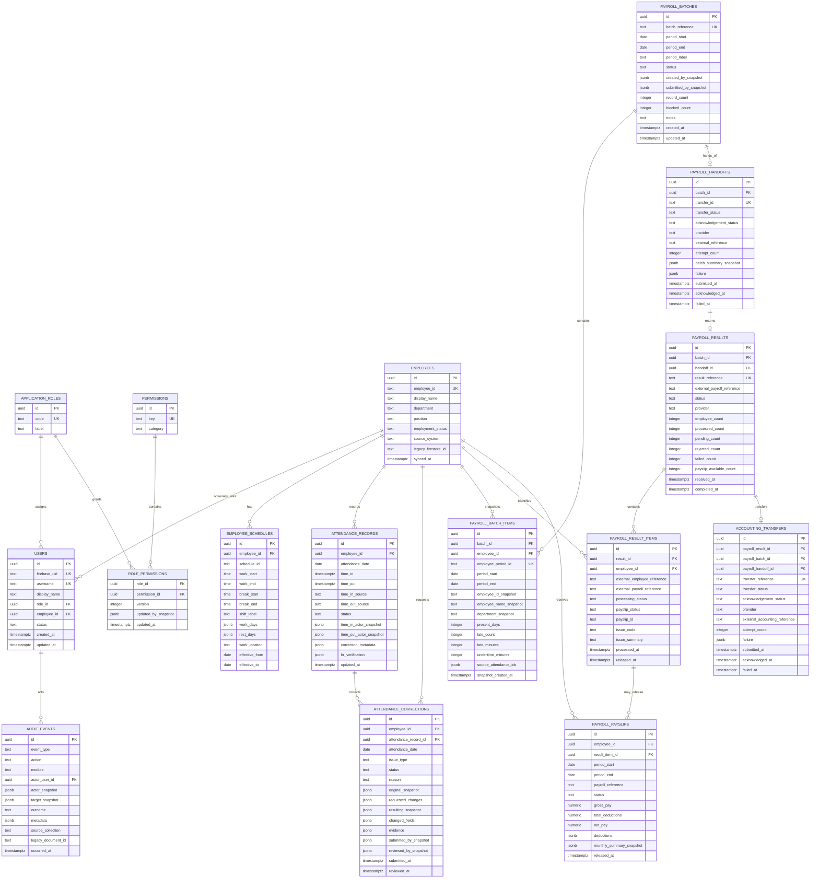

# DB-ARCH-006 - Proposed PostgreSQL ERD

This Mermaid diagram is the proposed target domain shape. It is intentionally
not a live schema and does not include future Bundy/HRPS import tables until
their contracts are approved.

The diagram keeps important historical snapshots even where an FK also
exists. The FK provides current integrity; the snapshot preserves what the
external system or actor looked like at the time of the workflow event.
